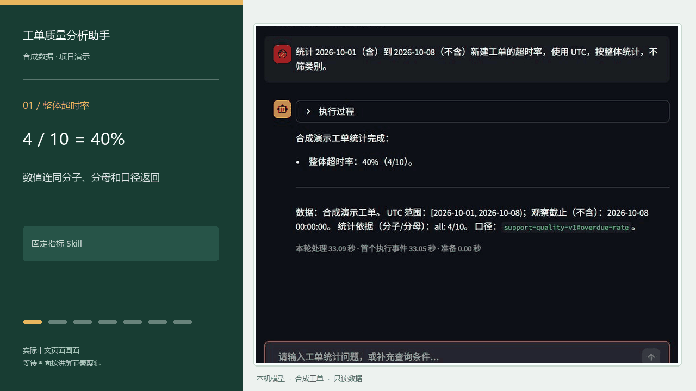
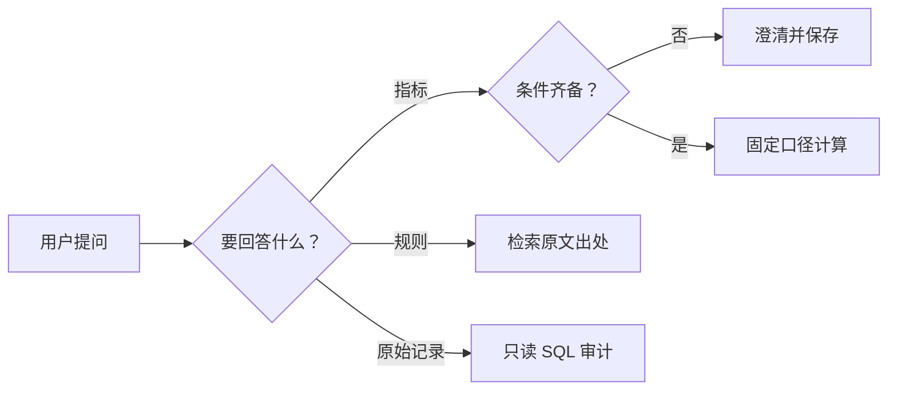

# 工单质量分析助手｜完整演示与设计复盘



动图展示一次连续操作：得到整体数字、按类别追问、核对规则出处、审计原始 SQL，最后验证模糊日期会先澄清。画面来自本项目的实际中文网页和合成数据；等待段经过剪辑，真实耗时见下文。

**这一页的主线：** 客服主管要带走可解释、可复核的超时率。我们在连续提问中发现旧日期误用、原始审计走错工具、SQL 未执行却被当作结果、会话切换丢失状态，于是把任务边界、执行证据和恢复逻辑补进系统，并逐项验证。

## 一个具体的使用场景

客服主管准备质量复盘，先问“上周有多少工单超时”，接着追问“哪个类别最严重”“未解决工单算不算”“原始表到底有哪些记录”。她要带走的是**可以解释和复核的结论**：同一时间范围、稳定的分子分母、规则出处，以及必要时能回到执行过的 SQL。临时查询若分散在报表、文档和数据库三个入口，追问时很容易丢掉原来的条件。

本项目用完全合成的工单构造这段工作流。15 条原始记录覆盖测试、重复、取消、未解决与时间边界；在演示日期内按业务规则筛出 10 条有效工单，其中 4 条超时。样本数量用于验证规则和失败分支，不代表企业真实数据。

| 用户连续提出的问题 | 系统实际交付的东西 | 主管为什么需要它 |
| --- | --- | --- |
| “10 月 1 日到 8 日的超时率？” | `4/10 = 40%`，附 UTC 范围、观察截止和口径版本 | 先得到可核算的整体结论 |
| “沿用刚才条件，按类别看” | account `3/4`、billing `0/2`、delivery `1/4` | 找到值得优先调查的类别，不把分类比例简单平均 |
| “未解决的算分母吗？” | 规则原文、章节和片段编号 | 在会上说明数字的定义和出处 |
| “原始表最大 id 是多少？” | 实际执行的只读 SQL 与结果 `15` | 区分原始记录审计与有效工单指标 |
| “这周超时率呢？” | 先问清 UTC 起止日期并保存待继续状态 | 不拿演示数据或旧会话日期冒充本周数据 |

## 问题是怎样被发现的

我们先跑通原有对话图和 SQL 子流程，再用合成工单做连续提问。单步“能回答”并不足够；真正暴露问题的是**追问、切换任务和切换会话**。

| 观察到的现象 | 原因定位 | 采取的改动 | 验证方式 |
| --- | --- | --- | --- |
| 旧会话里问“这周超时率”，回答沿用之前的 `2026-10-01` 至 `2026-10-08` | 只检查日期字段是否有值，无法区分它来自本轮还是历史；模型还可能直接复述旧答案 | 在模型调用前识别本轮相对时间，要求明确 UTC 起止日期；没有本轮查询证据时不输出新统计 | 真实网页重问“这周”，先出现澄清；补齐日期后才重新得到 `4/10` |
| 原始表 `MAX(id)` 曾被当成固定指标请求，反而要求填写指标和日期 | 指标与原始审计共用一组工具时，任务边界不清 | 按本轮问题收窄可见工具；原始记录进入 SQL 专项子流程，保留用户要求的包含范围 | 实际执行 `SELECT max(id) AS max_id FROM support_tickets`，结果为 `15` |
| 有时模型给出了 SQL 或文字，但还没有成功执行查询 | “生成了语句”与“获得执行结果”是两个状态 | 仅从本轮成功工具结果组装数值、SQL 和 CSV 证据；失败/未执行状态不作为完成结果 | 离线失败案例及真实本机 SQL 回放核对执行状态与独立查询值 |
| “新建对话”后旧页面清空了，后台状态却可能还在；切回待补充会话也丢失问题 | 页面状态与检查点状态没有一起切换 | 新对话使用新 Session ID；历史列表恢复消息、待补充问题和原检查点 | 进程内会话测试与真实网页新建、切回、补充后继续 |

这些修复围绕同一个判断：**当前回答能否指向当前请求的输入、工具执行和证据**。日期、业务口径和原始数据的范围各有不同的来源，不能只靠提示词要求模型“记住不要弄错”。

## 处理路径



每次只进入与当前问题对应的一条路径。三条路径分别返回数值与分子分母、规则片段与出处、或实际执行的 SQL 与结果；页面只展示本轮拿到的证据。澄清后沿原会话继续，另开会话不会继承这些条件。

| 环节 | 模型负责 | 程序负责 | 失败时用户看到什么 |
| --- | --- | --- | --- |
| 理解问题 | 将自然语言映射到有限任务和工具参数 | 限定本轮可用工具，检查日期与必填项 | 请求补充范围或指标 |
| 指标 Skill | 提出指标、日期、类别、分组 | 校验输入，执行固定参数化 SQL，返回分子、分母、版本 | 无数据、越界或执行失败的独立状态 |
| 规则查证 | 表达检索问题 | 分块、BM25 检索、引用装配与长度限制 | 资料未命中或检索失败，不编造规则 |
| 原始记录审计 | 在 SQL 专项子流程中选表和形成查询 | 限制只读执行，区分已执行与未执行，呈现 SQL/结果 | 明确未执行或失败，不引用旧结果 |
| 会话回答 | 继续追问或补充条件 | 保存/恢复检查点，按本轮工具结果生成可核对报告 | 保留待补充状态，不误报“已完成” |

主对话图、Text2SQL 子图、检查点和基础 Streamlit 页面沿用 OpenChatBI；这次围绕工单场景增加的任务收窄、指标 Skill、规则检索、证据处理和会话修复，分别可以从[任务路由](../openchatbi/tool/support_routing.py)、[指标计算](../openchatbi/analysis/support_quality.py)、[规则检索](../openchatbi/business_knowledge.py)、[SQL 证据](../openchatbi/tool/sql_handoff.py)与[页面处理](../sample_ui/streamlit_ui.py)核对。主图交给 SQL 子图是有限职责交接；指标问题本身是单工具调用。

## 两种查询为什么分开

### 固定指标：把口径锁在程序里

超时率的用户输入只有指标、UTC 起止日期、可选类别和分组。程序把分组限定为 `overall/category`，日期为左闭右开，最多查询 93 天、20 个类别；类别过滤值使用绑定参数。业务规则排除测试、重复和观察截止前取消的工单；**未解决的有效工单仍在分母里**。观察截止为 `2026-10-08 00:00:00 UTC`，超时判定也按这个时点，而不是按当前机器时间。

这让 `4/10` 可以拆回“4 条逾期、10 条有效”，分类 `3/4 + 0/2 + 1/4` 的分子分母也能重新相加核对。空集合返回无数据，不能报成 `0%`；平均处理时长没有已解决工单时返回空均值。SQL、参数与查询指纹随结果保留，便于定位一次计算使用的范围。

### 原始审计：保留用户明确要求的范围

主管核对原始表最大编号时，明确要求包括测试、重复和取消记录。此时把指标的排除条件套进去，就回答了另一个问题。因此原始审计交给 SQL 专项子流程，展示实际成功执行的语句和结果：

```sql
SELECT max(id) AS max_id FROM support_tickets;
```

结果 `15` 是原始表编号，不是有效工单数量，也不能拿来替代超时率分母。这个差异是演示中最容易让人理解“为什么需要任务边界”的例子。

## 为什么规则要带出处

当用户问“未解决工单算不算”，数据库只能给出记录，不能解释规则定义。规则资料按 Markdown 章节切成片段，默认使用 BM25；返回原文、`source_ref`、`chunk_id`、行号和版本，并限制返回条数与上下文长度。回答展示命中的原文，减少本机小模型改写规则时出现相反结论的机会。

这份资料规模很小，BM25 已足够支撑默认页面；本地向量模式另做过六个小样本的独立验证，但不作为页面默认链路，也不把该样本当成大规模检索效果。资料未命中与检索出错是不同状态，前者提示“当前资料没有匹配片段”，后者提示检查检索过程。

## 演示结果与延迟

页首 GIF 的先后顺序不代表实时响应速度。完整输入与预期结果见[演示脚本](../example/support_quality/PROJECT_CASE_STUDY.md)。

2026-10-25 用同一台机器、本地模型和独立演示会话录制 GIF 时，逐轮看到以下结果和页面读数。每一行只是一轮观察，并非性能基准：

| 操作 | 核对到的输出 | 本轮处理 | 首个执行事件 |
| --- | --- | ---: | ---: |
| 指定 UTC 日期问整体超时率 | `4/10 = 40%` | 33.09 秒 | 33.05 秒 |
| 沿用日期，按类别追问 | `3/4`、`0/2`、`1/4` | 16.96 秒 | 16.87 秒 |
| 询问未解决工单的分母规则 | 命中 `support-quality-v1#超时率` 原文 | 30.95 秒 | 30.90 秒 |
| 审计原始表最大编号 | SQL 专项流程执行并返回 `15` | 75.45 秒 | 43.38 秒 |
| 新会话直接问“这周” | 先请求明确 UTC 日期，没有输出比率 | 0.04 秒 | 0.02 秒 |

这里的“首个执行事件”是应用解析到的第一个流程事件，**不是首字节或一次独立模型调用的耗时**。SQL 路径在首事件后还需要选择、校验和执行查询，因此总处理时间明显更长；澄清路径在调用模型前被程序拦住。此前另一轮分类查询显示准备 `0.00 秒`、首事件 `27.51 秒`、总处理 `27.55 秒`。准备时间只显示两位小数，并不意味着初始化零耗时。浏览器绘制和网络传输不在这些应用内计时里。

本机配置使用 Ollama `qwen2.5:3b`，单次模型调用超时 90 秒、自动重试 0 次、最多 384 输出 token；固定指标完成后不再让模型重新计算数字。单次读数可用来解释用户等待发生在哪一段，不能推断平均延迟、p95、并发吞吐或外部 API 成本。四条路径的复现和记录方式见[延迟演示说明](LATENCY_DEMO.md)。

## 验收证据与适用范围

| 验证层次 | 已核对的事实 | 说明 |
| --- | --- | --- |
| 确定性回归 | 选定离线套件 360 项通过，涵盖口径、边界、检索、澄清、会话和前端状态 | 模型决策可由替身驱动，不能推断真实回答质量 |
| 本机真实页面 | 整体 `4/10`、分类 `3/4/0/2/1/4`、规则引用、原始 SQL `MAX(id)=15`，及待补充/历史恢复 | 使用合成数据与本地模型；不是线上用户指标 |
| 向量路径 | 本地 embedding 对六个小样本做过独立检索检查 | 页面默认走 BM25；样本不足以声称通用准确率 |
| 延迟 | 页面记录每轮总处理、准备和可见首事件时间 | 单机样本，不含 p95、排队或并发结论 |

项目当前面向单机演示和学习：数据为一个 SQLite schema，SQL 只读与工具白名单提供最小边界；没有正式多租户认证、完整 SQL 沙箱、长对话治理或生产化超时/限流。下一步如果进入真实业务，需要先补数据权限和端到端执行预算，再谈规模与性能目标。

## 来源与许可

本项目基于 [OpenChatBI](https://github.com/zhongyu09/openchatbi)（MIT）构建，保留原许可证和 Git 历史；主图、Text2SQL 子图、检查点与基础页面来自原项目，以上工单业务约定、检索与证据约束、中文演示及测试为本项目增量。
