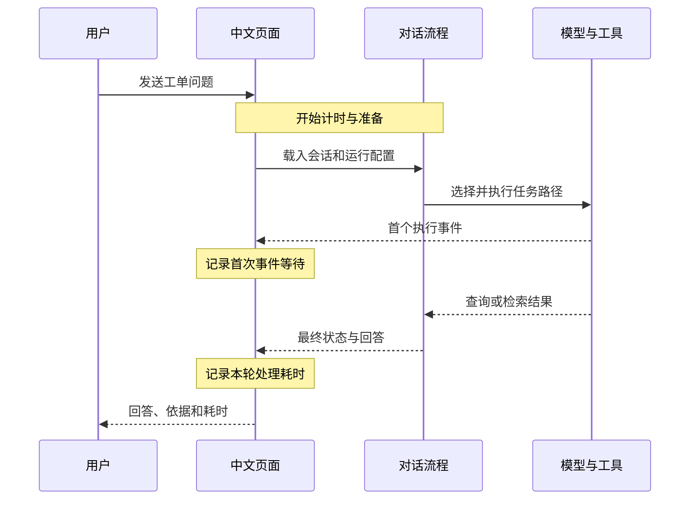

# 本机延迟演示

## 演示目标

现场展示一次用户提问从提交到结果的等待时间，并解释不同任务路径产生的耗时差异。页面在每条新回答下方显示总处理耗时；准备完成时显示准备耗时，有可展示的执行事件时显示首次事件等待：

| 页面指标 | 计时起止 | 用于观察 |
| --- | --- | --- |
| 本轮处理 | 开始处理消息 -> 执行结束并读取最终状态 | 一次任务在应用进程中的处理时间 |
| 首个执行事件 | 开始处理消息 -> 收到首个可展示的步骤或文本事件 | 用户等待第一条有效进展的时间 |
| 准备 | 开始处理消息 -> 图、模型配置及运行配置就绪 | 首次加载与会话准备的开销 |

计时使用单调时钟。数值展示到小数点后两位；结束后随本次回答留在页面，失败请求也会显示本轮处理时间。直接生成结果而没有流式步骤时，首次事件项省略。它们记录应用进程内的单次任务，浏览器绘制与网络传输另计。切换历史会话时，历史答案仍可恢复；本机耗时记录只保存在当前网页会话中。

## 现场操作

按[仓库首页](../README.md#本地演示)启动服务，在 [本机页面](http://127.0.0.1:8501/)新建对话，并按以下顺序提问。每轮等回答完成后，读出答案下方实际显示的耗时值。

| 轮次 | 输入 | 观察重点 |
| --- | --- | --- |
| 1. 指标计算 | `统计 2026-10-01（含）到 2026-10-08（不含）新建工单的超时率，使用 UTC，按整体统计，不筛类别。` | 固定口径工具返回 40%（4/10）；首次模型加载可能增加准备和首次事件等待 |
| 2. 规则检索 | `超时率分母包括未解决工单吗？请查规则并给出处。` | BM25 返回中文规则与来源；观察检索路径与指标路径的差异 |
| 3. 原始审计 | `请查询合成工单原始表中的最大 id，包括测试、重复、已取消记录，不作业务排除、不限制日期。给出真实 SQL 和查询结果，不要图表。` | SQL 专项流程有多步模型/工具交接，观察执行过程和总耗时 |
| 4. 澄清 | 新建对话后问 `这周超时率多少？` | 先确认 UTC 日期，保留待补充状态；观察无需实际数据库统计的路径 |

可把现场读数记录为“任务、准备、首事件、总处理、状态”五列。冷启动和随后轮次分开记录；比较时保留机器、模型、日期范围和是否首次加载这些条件。演示结果以页面当时的实测值为准，下面的单次样本不能代替现场读数。

2026-10-25 的一次本机网页验证：输入 `统计 2026-10-01（含）到 2026-10-08（不含）新建工单的超时率，按类别拆分。`，页面返回 account 3/4、billing 0/2、delivery 1/4；准备 0.00 秒、首个执行事件 27.51 秒、本轮处理 27.55 秒。这只是一轮本机样本，受模型加载状态和机器负载影响，不代表平均值或服务承诺。

## 如何解释等待

固定指标路径先由模型理解请求，再由参数化 SQL 计算，结果展示无需额外模型重算。规则路径涉及资料检索与来源装配。原始审计要经历表结构定位、SQL 生成与只读执行，步骤数更多。准备耗时在首次加载模型或初始化图时可能上升；首事件等待可帮助区分“还没看到进展”和“执行过程已经开始”。

当前配置的单次模型调用超时为 90 秒、自动重试为 0 次、单次输出上限为 384 token。页面读数可用于本机流程分析；如需服务级延迟目标，下一阶段应增加跨请求记录、分位数统计和并发测试。
